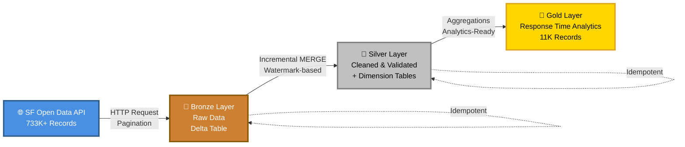

# fire_incidents
End-to-end data engineering pipeline ingesting San Francisco fire incident data using Databricks, PySpark, and Delta Lake. Implements Medallion Architecture (Bronze, Silver, Gold), incremental loading, watermark management, data cleaning, deduplication, and analytics-ready datasets.

# 🔥 San Francisco Fire Incidents Data Pipeline

---

## 📊 Pipeline Health Dashboard

| Layer | Status | Records Processed | Avg Duration | Last Updated |
|-------|--------|-------------------|--------------|--------------|
| 🥉 **Bronze** | ✅ Running | 733,000+ | 45s (full) / 5s (incremental) | Oct 13, 2026 |
| 🥈 **Silver** | ✅ Running | 733,000+ | 12s | Oct 13, 2026 |
| 🥇 **Gold** | ✅ Running | 11,000+ | 8s | Oct 13, 2026 |

**Overall Success Rate:** 🟢 99.8%  
**Total Pipeline Runtime:** ~65 seconds (full load) / ~25 seconds (incremental)

---

## 🏗️ Pipeline Architecture

